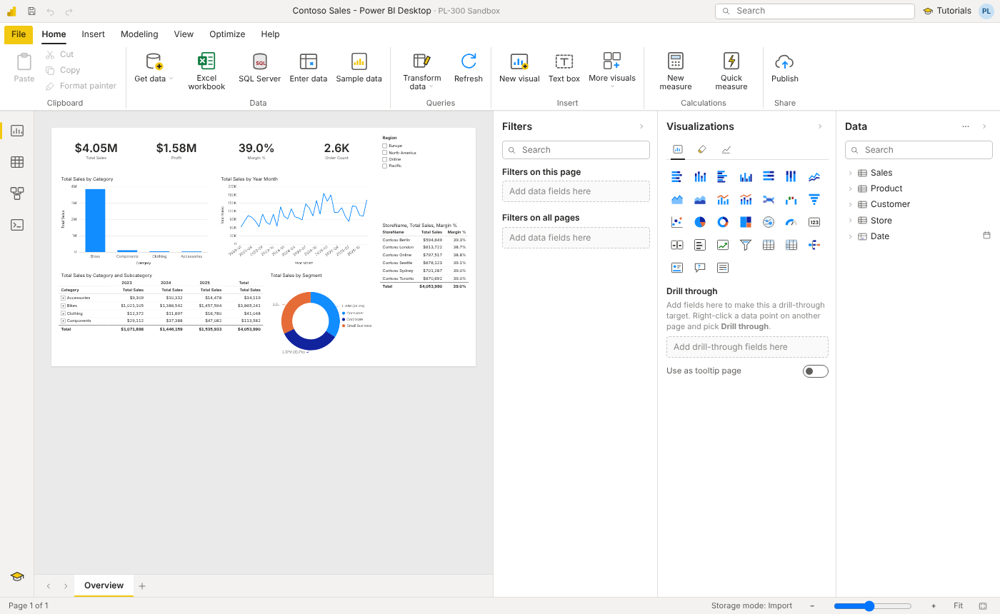

# PL-300 Sandbox

A practice environment for the **PL-300: Microsoft Power BI Data Analyst** exam that
recreates Power BI Desktop in the browser: same layout, same terminology, and real
engines underneath. Power Query runs actual M code, and the model runs actual DAX
with filter context, row context, context transition and relationship propagation.



## Running it

**No install:** download [`release/PL-300-Sandbox.html`](release/PL-300-Sandbox.html) and
open it in Chrome or Edge. It's one self-contained file that works offline. Your work
saves automatically in the browser; File › Save downloads a `.pbisandbox` project.

**From source:**

```
cd pl300-sandbox
npm install
npm run dev        # http://localhost:5173
npm test           # M and DAX engine tests
npm run release    # rebuilds release/PL-300-Sandbox.html
```

## What's inside

The window follows Power BI Desktop: File backstage, ribbon (Home, Insert, Modeling,
View, Optimize, Help, plus contextual Format, Data/Drill, Table tools, Column tools and
Measure tools), the view rail (Report, Table, Model, DAX query), the Filters /
Visualizations / Data panes, page tabs and the status bar.

**Get data.** Excel (.xlsx, .xlsm, .xls: sheets and named ranges, via the Navigator),
Text/CSV/TSV/TXT (delimiter detection, preview), JSON (nested records), XML, Parquet,
Folder (Combine & Transform with the Sample File / Transform File helpers), Enter data,
Blank query, and a built-in **SQL Server**: `Sql.Database("localhost", "ContosoDW")`.
Uploaded files live under `C:\Sandbox\Files`, and `File.Contents` finds them by name,
so M copied from a real report works once you upload its files.

**Power Query Editor.** Queries pane with groups, formula bar, Applied Steps (rename,
delete, delete until end, insert after, move, extract previous), Advanced Editor with
syntax checking and IntelliSense, column quality / distribution / profile, type badges,
sort & filter menus, and the Home, Transform and Add Column ribbons: remove/keep rows,
remove duplicates and errors, replace values and errors, fill, split (delimiter,
characters, positions, transitions, into rows), merge columns, extract, format, parse,
group by (basic/advanced), pivot, unpivot (other/selected/only selected), transpose,
custom, conditional, index and invoke-function columns, date/number transforms, merge
queries (all six join kinds, fuzzy), append (two or more), parameters, functions,
reference/duplicate, enable load / include in refresh, query dependencies. Each command
writes the same M step Power BI writes, with the same step names.

**M engine.** Lazy `let` evaluation, `each`, functions, records, lists, tables, types,
`try … otherwise`, `meta`, cell-level errors, and nearly 400 library functions
(`Table.*`, `List.*`, `Text.*`, `Number.*`, `Date.*`, `Record.*`, `Splitter`/`Combiner`/
`Replacer`, …).

**Model.** Model view with draggable table cards, drag-to-relate, cardinality
(1:\*, 1:1, \*:\*), cross-filter direction, active/inactive relationships, autodetect,
Manage relationships, Properties pane, hierarchies, display folders, sort by column,
data categories, summarization, formats, hide/unhide, mark as date table, auto date/time
hierarchies, calculated columns and tables, measures, quick measures, what-if
parameters, groups and bins, and row-level security with Manage roles and View as
(including `USERPRINCIPALNAME()` for dynamic RLS).

**DAX engine.** About 230 functions, including CALCULATE/CALCULATETABLE, ALL,
ALLEXCEPT, ALLSELECTED, REMOVEFILTERS, KEEPFILTERS, USERELATIONSHIP, CROSSFILTER,
TREATAS, the X iterators, RANKX, TOPN, SUMMARIZE, SUMMARIZECOLUMNS, ADDCOLUMNS,
GENERATE, the time-intelligence family (TOTALYTD, DATESYTD, SAMEPERIODLASTYEAR, DATEADD,
PARALLELPERIOD, DATESINPERIOD, opening and closing balances…), PATH functions, and
FORMAT. The DAX query view runs `DEFINE` / `EVALUATE` / `ORDER BY`.

**Report.** About 30 visuals: bar and column (stacked, clustered, 100%), line, area,
combo, ribbon, waterfall, funnel, scatter, pie, donut, treemap, gauge, card, multi-row
card, KPI, slicer (list, dropdown, tile, between, hierarchy), table and matrix (totals,
subtotals, stepped layout, conditional formatting), decomposition tree, key influencers,
Q&A, narrative, text boxes, buttons, shapes and images. Also: field wells with
summarization and "show items with no data", visual / page / report filters (basic,
advanced, Top N, relative date, lock and hide), cross-filter and cross-highlight, edit
interactions, drill down/up/next level/expand, drill through with a Back button,
bookmarks, selection pane, Analytics pane lines, themes, Performance analyzer, export
data, show as a table and focus mode.

**Tutorials.** 27 hands-on labs grouped by the exam's skill areas (Prepare, Model,
Visualize and analyze, Manage and secure). Each loads its own sample data, checks your
work live, and ends with exam-style questions and explanations. Examples: all six merge
join kinds, append with mismatched columns, combine files, unpivot, group by,
parameters and functions, star schema and cardinality, date tables, role-playing dates
with USERELATIONSHIP, CALCULATE and filter context, time intelligence, RANKX/TOPN,
many-to-many bridges, PATH hierarchies, filters at each level, interactions and drill
through, bookmarks, AI visuals, what-if parameters, RLS, and service concepts.

**Practice exam.** A timed mock exam (or a study mode that checks each answer) drawn from
a bank of exam-format questions: single and multiple choice, Yes/No statement series,
ordering, and drop-down "hot area" items, some with a scenario. Questions are weighted
like the real exam across the four skill areas, and about half cover the Power BI
service and features the sandbox can't run: workspace roles, apps, sharing and Build
permission, gateways, scheduled and incremental refresh, alerts and subscriptions,
endorsement, sensitivity labels, Direct Lake vs DirectQuery vs Import, privacy levels,
calculation groups, visual calculations, Copilot, paginated reports, sync slicers,
report-page tooltips, mobile layout, personalization and automatic page refresh. The
results page scores out of 1,000 (700 to pass), breaks it down by skill area and links
each question to a lab. A **Syllabus coverage** tab lists every skill in the
April 20, 2026 outline and shows whether it has a lab, works in the sandbox, or is
covered by questions only.

## Files

| Open | Notes |
| --- | --- |
| `.pbisandbox` | The sandbox's own project file (queries, model, report and uploaded files). |
| `.pbit` | Power BI templates: queries, tables, measures, relationships, roles, hierarchies and report pages are imported. Upload the source files the queries use, then Refresh. |
| `model.bim` / TMSL JSON | Semantic models from a `.pbip` project or Tabular Editor. |
| `.pbix` | Can't be read: its data is in Power BI's compressed VertiPaq format. In Power BI Desktop use File › Export › Power BI template, and open the `.pbit`. |

File › Export writes the model as `model.bim` (TMSL) and any table as CSV.

## Limits

This is a learning tool, not a replacement for Power BI, and it isn't affiliated with Microsoft.

- Data sources that need a network connection (Web, OData, SharePoint, Oracle,
  Dataverse…) aren't available; download the data and import the file instead.
- The Power BI service (workspaces, apps, gateways, scheduled refresh, sharing,
  dashboards) isn't simulated; the practice exam and the last tutorial cover it.
- Maps draw as bar charts (no map tiles offline). Column From Examples, R/Python
  scripts, custom visuals, field parameters and mobile layout aren't included.
- DAX follows the documented semantics closely, but some edge cases differ from the
  real VertiPaq engine (for example, the blank row added for unmatched keys).
- Everything runs in the browser, so very large files (hundreds of thousands of rows)
  get slow.

## Layout of the code

```
src/m/          M (Power Query) parser, evaluator, standard library, data sources
src/dax/        DAX parser, engine (filter/row context, relationships), function library
src/model/      model types, refresh pipeline, relationship autodetect
src/report/     visual definitions and the query layer behind each visual
src/ui/         the Power BI Desktop interface (ribbon, views, panes, Power Query Editor, dialogs)
src/tutorials/  tutorial scenarios, content and UI
src/data/       the generated Contoso sample files and the sandbox SQL database
tests/          engine tests (vitest)
```
